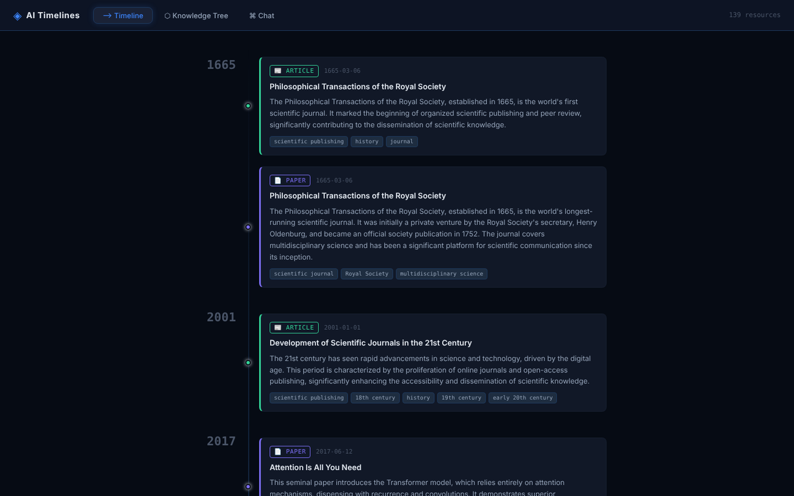
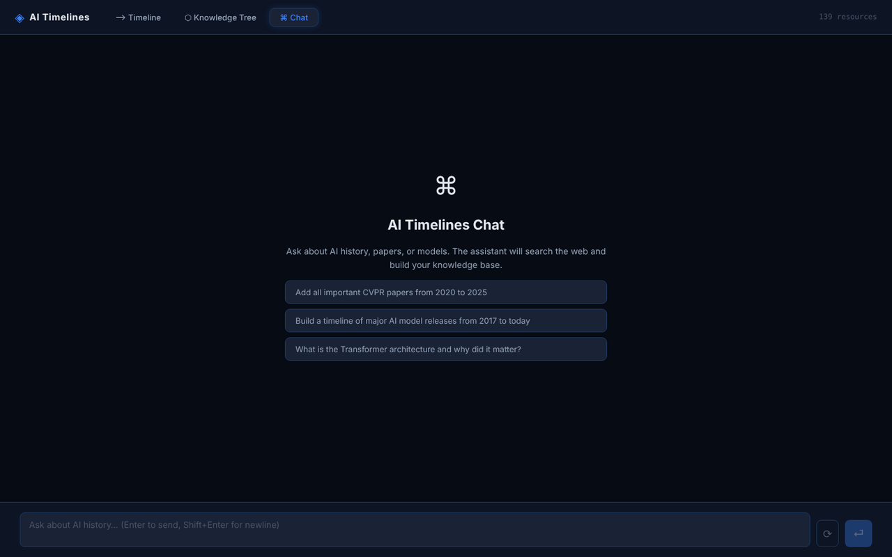

# AI Timelines

A research agent that builds its own knowledge base. Ask it about a topic; it searches the
web, reads pages in a headless browser, and files what it finds as dated, linked resources
that you can explore as a timeline or a dependency graph.

<!-- showcase -->
| Timeline | Research chat |
|---|---|
|  |  |

## Why

Most chat research is thrown away when the conversation ends. Here every source the agent
uses becomes a structured record (title, date, URL, type, summary, connections) in
`data/knowledge-base.json`, so the knowledge accumulates across sessions and can be browsed
without asking again. The repo ships with a seed knowledge base of 139 resources.

## Architecture

```
React UI (Vite)
 ├── Chat tab      ── agent loop (src/chat/agent.ts)
 │                     tools: search_web · browse_page · add_resources · signal_done
 ├── Timeline tab  ── resources ordered by date
 └── Tree tab      ── React Flow + dagre graph of resource connections
        │
        ▼  /api/*  (Vite dev-server plugin, server/api-plugin.ts)
 ├── POST /api/chat           → Azure OpenAI chat completions (tool calling)
 ├── POST /api/search         → web search (server/search.ts)
 ├── POST /api/browse         → Playwright page fetch and text extraction
 ├── GET  /api/kb             → read knowledge base
 └── POST /api/kb/resources   → upsert resources and merge connections
```

The API runs as a Vite middleware plugin, so a single `npm run dev` serves both UI and
backend with no separate server process.

## Tech stack

TypeScript, React 18, Vite 6, @xyflow/react + dagre, Playwright (headless Chromium),
Azure OpenAI (chat completions with tools), duck-duck-scrape.

## Quickstart

```bash
npm install
npx playwright install chromium
cp .env.example .env.local   # Azure OpenAI settings
npm run dev                  # http://localhost:5173
```

## Configuration

`.env.local` (see `.env.example`): `AZURE_OPENAI_ENDPOINT`, `AZURE_OPENAI_KEY`,
`AZURE_OPENAI_DEPLOYMENT`, `AZURE_OPENAI_API_VERSION`.

## Design decisions

- **The agent writes to a store, not to the chat.** `add_resources` is a tool, so the model
  decides what is worth keeping and the UI renders from the store, not from the transcript.
- **Upsert with connection merging** (`server/kb-store.ts`) keeps repeated research from
  duplicating resources and grows the graph instead.
- **Browser reading is server-side**, which avoids CORS and lets the agent read pages that
  need JavaScript to render.

## Limitations and roadmap

- The JSON file store is single-user; a SQLite or vector store would scale further and enable
  semantic search over summaries.
- The API exists only in the Vite dev server; a production build needs a small standalone
  server.
- No evaluation of summary accuracy yet; citing quoted spans from the browsed page is next.

## License

MIT
